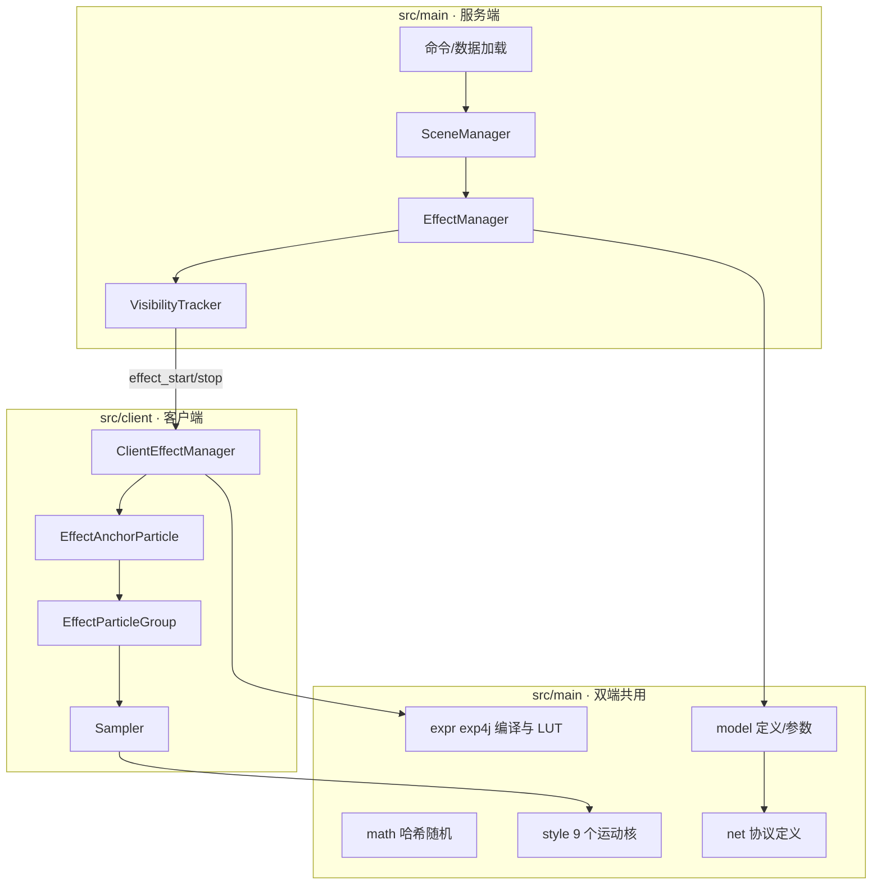
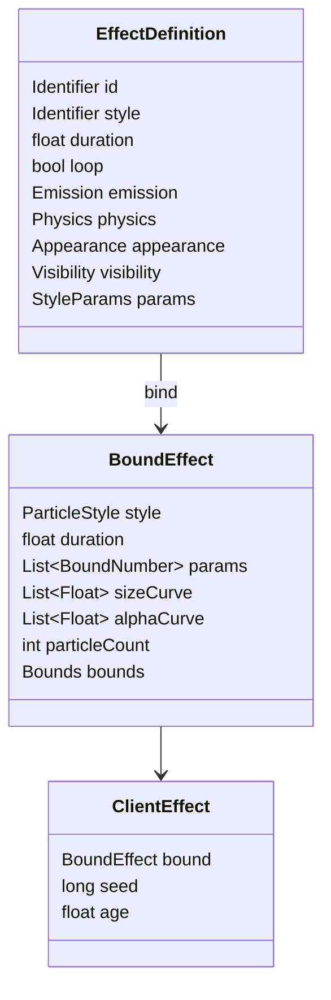
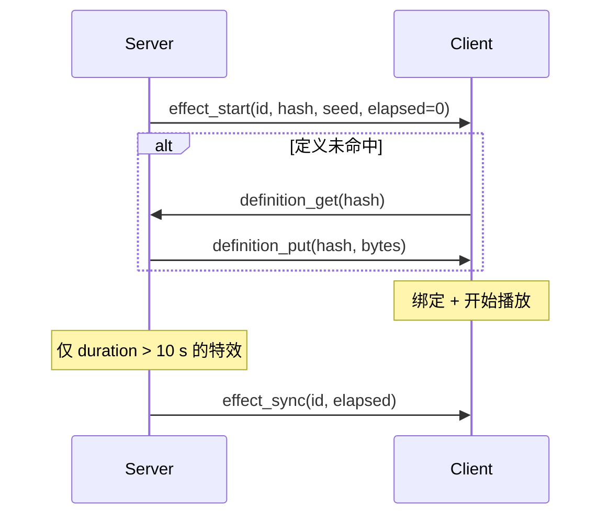
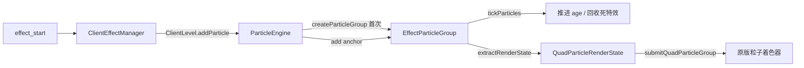

# 架构设计

> AstrorbitsParticle · Minecraft 26.2 / Fabric · 协议 v1

本文描述"服务端下发参数 + 客户端确定性模拟"的演唱会特效系统。
每种样式的参数与运动学见 [粒子样式表](粒子样式表.md)。

---

## 1. 目标与约束

### 1.1 功能目标

1. 服务端只下发**特效参数、随机种子、播放进度**，粒子由客户端自己计算、自己渲染。
2. 特效只下发给**位于演唱会场景内**且**在距离范围内**的客户端。
3. 客户端在特效播放中途才满足可见条件时，补发参数、进度和种子，让它**立刻**看到播到一半的画面。
4. 参数支持表达式（exp4j），使速度、半径、转速等可以随时间变化。
5. 开放的样式架构：新增一种样式只需实现一个运动核，不碰网络、渲染、生命周期。

### 1.2 非目标（v1）

- 不做 GPU 粒子（instancing / compute shader）；先在 CPU 上把批处理做好。
- 不做逐粒子碰撞、弹跳、流体交互。
- 不做客户端预测回滚。
- 不替代原版粒子系统。

### 1.3 硬约束

| 项 | 值 |
| --- | --- |
| Minecraft | 26.2（Loom 1.19-SNAPSHOT） |
| Loader / API | Fabric Loader 0.20.1，Fabric API 0.161.0+26.2 |
| 语言 | Kotlin 2.4.21，JVM target 25 |
| 源码布局 | `splitEnvironmentSourceSets()`：`src/main` 双端，`src/client` 仅客户端 |
| 服务端成本 | 每 10 tick 一次 O(玩家 × 特效) 扫描，不随粒子数增长 |
| 网络成本 | 常规特效启动包 ≤ 80 B |
| 客户端成本 | 1 万粒子单帧 ≤ 2 ms CPU |

---

## 2. 总体架构



### 2.1 模块职责

| 模块 | 包 | 职责 |
| --- | --- | --- |
| 模型 | `model` | `EffectDefinition` / `Emission` / `Physics` / `Appearance` / `Visibility`，JSON 编解码 |
| 表达式 | `expr` | exp4j 封装、变量白名单、常量折叠、时变参数烘 LUT |
| 随机 | `math` | 64 位哈希、球面/锥形采样、噪声 |
| 样式 | `style` | `ParticleStyle` SPI 与 9 个内置实现（纯数学，无渲染依赖） |
| 协议 | `net` | `CustomPacketPayload` 定义、编解码、版本常量 |
| 场景 | `server.scene` | 场景加载、成员判定、包围盒 |
| 特效服务端 | `server.effect` | 活跃特效注册表、生命周期、订阅差量 |
| 客户端特效 | `client.effect` | 接收、缓存定义、驱动采样与渲染 |
| 渲染 | `client.render` | `ParticleGroup` / 锚点粒子 / 批提交 |

样式放在 `common` 而不是客户端，是为了让服务端也能计算包围球、做参数校验，
并且**保证两端用同一份数学**——这是"确定性"的前提。

---

## 3. 数据模型

### 3.1 三段式



| 阶段 | 类型 | 内容 | 何时 |
| --- | --- | --- | --- |
| 定义期 | `EffectDefinition` | 原始字段 + 已编译表达式 + 参数模式 | 数据包加载 / 收到网络定义时 |
| 绑定期 | `BoundEffect` | 表达式→常量或 LUT，曲线→数组，预算粒子数、包围球 | 特效启动时，每特效一次 |
| 运行期 | `ClientEffect` | `age`、`seed`、采样输出 | 每帧 |

**运行期不出现任何解析、字符串、装箱。** 这是整份设计里最硬的一条规则。

### 3.2 参数值

```kotlin
sealed interface ParamValue {
    data class Num(val raw: String) : ParamValue         // "6.0" 或 "6*(1-u)"
    data class Vec3(val x: Float, val y: Float, val z: Float) : ParamValue
    data class Rgb(val r: Float, val g: Float, val b: Float) : ParamValue
    data class Curve(val points: FloatArray) : ParamValue // [u0,v0,u1,v1,...]
    data class Gradient(val points: FloatArray) : ParamValue
    data class Enum(val name: String) : ParamValue
}
```

`Num` 保留原始字符串，编译在 `ExprCompiler` 里做一次，结果写进 `BoundEffect`。
样式通过 `StyleSchema` 声明每个参数的类型、默认值、范围，校验与文档都由它生成。

### 3.3 服务端特效实例

```kotlin
class EffectInstance(
    val id: Long,
    val definition: EffectDefinition,
    val bound: BoundEffect,
    val seed: Long,
    val dimension: ResourceKey<Level>,
    val origin: Vec3,
    val startTick: Long,
    val endTick: Long,
    val bounds: Bounds,
    val subscribers: MutableSet<UUID>
)
```

`bound` 在服务端只用来算包围球和校验，不做粒子计算。

---

## 4. 表达式子系统（exp4j）

### 4.1 依赖

```groovy
repositories { mavenCentral() }

dependencies {
    implementation "net.objecthunter:exp4j:0.4.8"
    include "net.objecthunter:exp4j:0.4.8"     // jar-in-jar，随模组分发
}
```

exp4j 0.4.8 是最后一个发布版本（2017），无传递依赖、体积约 40 KB。
`include` 会把 jar 嵌进模组，Fabric Loader 会自动把它加入类路径，服务端与客户端都能用。

已知取舍：

| 风险 | 处理 |
| --- | --- |
| 项目已停止维护 | 只用它做纯数值求值，不依赖高级特性；封装在 `expr` 包内，必要时可整体替换 |
| `Expression` 可变、非线程安全 | 每个 `BoundEffect` 持有自己的实例，只在其所属线程求值；需要跨线程预计算时另建实例 |
| 报错信息粗糙 | 编译期捕获 `IllegalArgumentException`，回退默认值并带上参数路径记日志 |
| 表达式可能很长 | 长度上限 256 字符；编译结果按字符串缓存（LRU 512） |

### 4.2 变量与函数

| 变量 | 含义 |
| --- | --- |
| `t` | 特效局部时间（秒） |
| `d` | 总时长（秒） |
| `u` | `t/d` |
| `n` | 粒子数 |

exp4j 内置 `abs acos asin atan cbrt ceil cos cosh exp floor log log10 log2 sin sinh sqrt tan tanh`、
常量 `pi` `e`、运算符 `+ - * / % ^`。模组额外注册 `clamp(a,x,b)`、`mix(a,b,k)`、
`smoothstep(a,b,x)`、`fract(x)`、`sign(x)`、`step(a,x)`。

变量白名单在编译时固定：`ExpressionBuilder(src).variables("t","d","u","n")`，
未声明的标识符在 `validate()` 阶段就报错，不会留到运行期。

### 4.3 求值策略

```kotlin
sealed interface BoundNumber {
    @JvmInline value class Const(val v: Float) : BoundNumber
    class Lut(val samples: FloatArray, val duration: Float) : BoundNumber
}
```

- **常量表达式**（不含 `t`/`u`，也不依赖 LUT）：编译后立即 `evaluate()` 成 `Float`，之后零成本。
- **时变表达式**：绑定期按 `K = clamp(ceil(d*5), 16, 256)` 个采样点烘成 `FloatArray`，
  运行期 `sample(t) = lerp(lut[i], lut[i+1], f)`，无三角函数、无分配。
- **需要积分的量**（螺旋的角位移、轴向位移）：对表达式做累积梯形积分，存成单调 LUT，
  采样时取增量。

一条 `Lut` 采样约 5 ns；一个特效通常有 3–6 条 LUT，逐粒子只读其中几条。

### 4.4 曲线

`sizeByAge` / `alphaByAge` / `colorByAge` 与表达式共用同一套 `Lut`，只是采样点直接来自关键帧。
于是"表达式参数"和"关键帧曲线"在运行期是同一种东西，样式代码不需要区分。

---

## 5. 网络协议

### 5.1 为什么不用原版粒子包

原版 `ClientboundLevelParticlesPacket` 只能表达"一个 `ParticleOptions` + 位置/偏移/速度/数量"，
无法携带种子、播放进度、表达式定义；一个特效拆成一万包会把带宽打爆。
所以走自定义 `CustomPacketPayload`：**一包描述一整个特效**。

### 5.2 Payload 列表

全部注册在 `PayloadTypeRegistry.clientboundPlay()` / `serverboundPlay()`，版本常量 `PROTOCOL = 1`。

| id | 方向 | 触发 | 作用 |
| --- | --- | --- | --- |
| `hello` | C2S | 玩家进服 | 声明协议版本、RNG 版本、客户端粒子预算 |
| `effect_start` | S2C | 特效开始 / 玩家中途满足条件 | 启动或接续一个特效 |
| `effect_stop` | S2C | 特效结束 / 玩家离开可见范围 | 按 id 批量停止 |
| `definition_get` | C2S | 收到未知 hash | 请求缺失的定义 |
| `definition_put` | S2C | 响应请求 | 下发定义字节 |
| `effect_sync` | S2C | 长特效（> 10 s）每 5 s | 校正播放进度 |

### 5.3 `effect_start` 字段

```text
varint  protocolVersion
long    effectId            // 服务端自增，全局唯一
long    definitionHash      // 定义内容哈希，用于缓存与一致性
long    seed                // 随机流种子
long    startGameTime       // 特效开始时的服务端 game time
varint  elapsedTicks        // 发送时刻已播放的 tick 数
float   originX, originY, originZ
float   yaw, pitch, scale
```

约 64 B。`definitionHash` 命中客户端 LRU 缓存时到此为止；否则客户端发 `definition_get`。

### 5.4 定义下发

```text
varint  protocolVersion
long    definitionHash
varint  length
byte[]  payload        // 定义 JSON 的 UTF-8 字节
```

- 服务端为每个定义缓存序列化后的 `byte[]`，下发时零拷贝写出。
- 客户端缓存上限 64 个定义，LRU 淘汰；`effect_start` 命中缓存即播放。
- 定义体积典型 300–900 B（含表达式字符串），只在首次出现时发一次。

### 5.5 时序



**关键点**：客户端拿到 `startGameTime` 与 `elapsedTicks` 后，先按 `elapsedTicks` 定位到当前帧，
再以自己的单调时钟推进；`effect_sync` 只在漂移超过 0.25 s 时才真正跳变。

### 5.6 兼容与降级

- 客户端未装模组：`ServerPlayNetworking.canSend(player, type)` 返回 `false`，
  服务端直接跳过该玩家；可配置为回退到一两发原版粒子作为提示。
- 协议版本不匹配：服务端忽略该玩家（不踢人），日志记一次。
- 未知样式：客户端丢弃该特效并记日志，不影响其他特效。

---

## 6. 可见性与中途加入

### 6.1 场景定义

场景是服务端配置（`config/astrorbitsparticle/scenes.json`），带世界与包围盒：

```json
{
  "scenes": [
    {
      "id": "astrorbitsparticle:main_stage",
      "dimension": "minecraft:overworld",
      "min": [-48, 56, -48],
      "max": [48, 144, 48],
      "viewDistance": 128.0,
      "scanInterval": 10
    }
  ]
}
```

场景包围盒是"是不是观众"的判定，距离是"看不看得见"的判定，两者都要满足。

### 6.2 判定

```text
scene       = e.scene                                  // requireScene=false 的全局特效可能为 null
inScene     = scene != null && scene.contains(p.pos)
viewLimit(e)= scene != null ? min(scene.viewDistance, def.visibility.viewDistance)
                            : def.visibility.viewDistance

eligible(p, e) =
      p.dimension == e.dimension
   && (inScene || !def.visibility.requireScene)
   && distanceSq(p.pos, e.bounds.center) <= (viewLimit(e) + e.bounds.radius)²
```

- `bounds` 由 `BoundEffect` 在绑定期采样 24 个时间点求出包围球，比手写"AABB + 半径"可靠。
- **迟滞**：进入用 `R`，退出用 `1.15R`；避免玩家在边界抖动导致反复 start/stop。
- **错峰**：扫描按 `player.id % scanInterval` 分摊到不同 tick，避免 20 tick 周期性的尖峰。

### 6.3 订阅差量

```kotlin
// 每 scanInterval tick
for (effect in activeEffects) {
    for (player in playersIn(effect.dimension)) {
        val want = eligible(player, effect)
        val has  = player.id in effect.subscribers
        when {
            want && !has -> sendStart(player, effect, elapsed = serverTick - effect.startTick)
            !want && has -> sendStop(player, effect.id)
        }
    }
}
```

`sendStart` 里的 `elapsed` 就是"播放进度"：

```kotlin
var elapsed = serverTick - effect.startTick
if (effect.definition.loop) {
    elapsed %= durationTicks
} else if (elapsed >= durationTicks) {
    return                       // 已经放完，不补发
}
```

### 6.4 中途加入为什么能直接正确

因为所有粒子的出生时刻、寿命、位置都是 `(seed, index, t)` 的**闭式函数**（见样式表 1.4）：

- 客户端拿到 `elapsed = 2.0 s`，直接令 `t = 2.0` 采样；
- 该出生但还没死的粒子会自动出现，早该死掉的自动不出现；
- 喷泉这类"持续发射"的样式，也只需要 `birth_i < t < birth_i + life_i` 的索引筛选。

不需要重放、不需要补发历史粒子、不需要等待。这是选择"解析式"而不是"逐帧积分"的直接收益。

### 6.5 生命周期边界

| 事件 | 处理 |
| --- | --- |
| 玩家死亡/重生 | 清空该玩家的订阅集，重生后重新扫描（新位置大概率不满足条件） |
| 换维度 | 维度不匹配 → 差量里自然发 `stop` |
| 断线重连 | 新连接无订阅状态，首次扫描重新 `sendStart(elapsed)` |
| `/reload` | 已绑定特效保持旧 `BoundEffect`，新特效用新定义；定义 hash 变化会让客户端重新拉取 |
| 服务端卡顿 | `elapsed` 以 game time 为准，跳过的时间由客户端一次性补上（`dt` 上限 50 ms） |

---

## 7. 客户端模拟

### 7.1 确定性随机

不使用 `java.util.Random`，也不用 Minecraft 的 `RandomSource`——它们的行为随版本可能变化。
自建 4 行 splitmix64，写进协议：

```kotlin
private val M1 = 0xBF58476D1CE4E5B9uL.toLong()
private val M2 = 0x94D049BB133111EBuL.toLong()
private val K1 = 0x9E3779B97F4A7C15uL.toLong()
private val K2 = 0xC2B2AE3D27D4EB4FuL.toLong()

private fun mix(z0: Long): Long {
    var z = z0
    z = (z xor (z ushr 30)) * M1
    z = (z xor (z ushr 27)) * M2
    return z xor (z ushr 31)
}
fun hash(seed: Long, stream: Int, index: Int, draw: Int = 0): Long =
    mix(seed xor (stream.toLong() * K1) xor (index.toLong() * K2) xor (draw.toLong() shl 32))
fun unit(seed: Long, stream: Int, index: Int, draw: Int = 0): Float =
    (hash(seed, stream, index, draw) ushr 40).toFloat() * (1f / (1 shl 24))
```

`hash64`、流编号、取用顺序共同构成 `rngVersion = 1`，改动即为不兼容变更。

### 7.2 采样

```kotlin
class ClientEffect(val bound: BoundEffect, val seed: Long) {
    var age = 0f           // 秒，单调递增
    fun sampleInto(out: ParticleBuffer) { bound.style.sample(bound, seed, age, out) }

    // 中途加入：直接把 age 设到目标进度，无需重放
    fun seek(seconds: Float) { age = seconds }
}
```

`ParticleBuffer` 是结构体数组（SoA）：`FloatArray` × {pos, size, alpha, rgb, uv}，预分配、可复用。
`sampleInto` 的实现是纯计算：查 LUT、读哈希、写数组，没有对象分配、没有虚调用嵌套。

### 7.3 时间推进

```kotlin
val now = System.nanoTime()
val dt = ((now - lastNanos) / 1e9).coerceIn(0.0, 0.05).toFloat()   // 单帧最多补 50 ms
age += dt
lastNanos = now

// 中途加入时直接跳到进度点，再按帧推进
age = elapsedSeconds + (now - recvNanos) / 1e9f
```

- 用 `nanoTime` 而不是 tick，保证 60/144 Hz 下运动平滑；`partialTick` 只用于渲染插值。
- `dt` 上限 50 ms，避免 GC/卡顿后粒子瞬移。
- 单机暂停（`Minecraft.isPaused()`）时冻结。

### 7.4 状态式兜底

个别未来的样式（碰撞、弹簧、跟随实体）无法解析。留一个扩展点：

```kotlin
interface StatefulStyle : ParticleStyle {
    /** 从 0 重放到 age；返回是否完成 */
    fun replayTo(age: Float): Boolean
    val maxWarmupTicks: Int
}
```

中途加入时最多重放 `maxWarmupTicks`（默认 200 tick），超出则从"看起来合理"的状态开始。
v1 的 9 个样式全部是解析式，不会走到这条路径。

---

## 8. 客户端渲染

### 8.1 26.2 的管线

26.2 把粒子拆成了三段：

1. `ParticleEngine.tick()` → 每个 `ParticleGroup.tickParticles()`
2. `ParticleEngine.extract(ParticlesRenderState, Frustum, Camera, partialTick)` → 每个 `ParticleGroup.extractRenderState(...)`
3. `ParticlesRenderState.submit(...)` → `SubmitNodeCollector.submitQuadParticleGroup(QuadParticleRenderState)`

Fabric API 提供了两个关键注册点：

- `ParticleProviderRegistry`：`ParticleType` → `ParticleProvider`
- `ParticleGroupRegistry.register(renderType) { engine -> ParticleGroup }`：为一类渲染层换掉默认的 `QuadParticleGroup`

### 8.2 接入方式



**锚点粒子技巧**：自定义 `ParticleRenderType("astrorbitsparticle:effect", "AOP")`，
客户端注册它的组工厂。收到 `effect_start` 后不直接调引擎内部方法，而是走标准路径：

```kotlin
level.addParticle(EffectAnchorOptions(effectId), x, y, z, 0.0, 0.0, 0.0)
```

`ParticleProvider` 造出一个**不渲染**的 `EffectAnchorParticle`，它的 `getGroup()` 返回自定义类型。
引擎首次遇到该类型时用工厂创建 `EffectParticleGroup`，再 `add(anchor)`；组在 `add` 里把
`ClientEffect` 挂进自己的活动列表，锚点粒子本身只负责"让组存在，并与特效同生共死"。

锚点用的 `ParticleOptions` 仍然需要注册一个 `ParticleType`，否则 `ParticleEngine` 查不到 provider：

```kotlin
val EFFECT_ANCHOR: ParticleType<EffectAnchorOptions> = Registry.register(
    BuiltInRegistries.PARTICLE_TYPE, id("effect_anchor"),
    FabricParticleTypes.complex(EffectAnchorOptions.CODEC, EffectAnchorOptions.STREAM_CODEC)
)
```

它永远不经过原版粒子包，两个 codec 只是注册接口要求的占位（仍建议写成合法实现，
以便 `/particle` 命令和调试工具有个能用的入口）。

这样不需要 mixin、不碰 `ParticleEngine` 的私有字段，也不影响原版粒子。

### 8.3 批渲染

`EffectParticleGroup.extractRenderState` 里：

```kotlin
val rs = QuadParticleRenderState()
val scratch = ParticleBuffer()                    // 复用的 SoA 缓冲
for (effect in visibleEffects) {
    if (!frustum.isVisible(effect.bounds.aabb)) continue
    effect.sampleInto(scratch)                    // age 已含帧插值
    val layer = layers[effect.blend]              // 按贴图 + 混合模式分组
    val stride = effect.lodStride(distTo(effect))
    for (i in 0 until scratch.count step stride) {
        rs.add(layer, scratch.x[i], scratch.y[i], scratch.z[i], /* size, color, alpha, uv, light */)
    }
}
return rs
```

- 所有粒子写进同一个 `QuadParticleRenderState`，每个 layer 一次 draw call。
- 不创建任何 `Particle` 对象：省掉每个粒子 ~100 B 的对象头与 GC 压力。
- `add` 是纯字段写入，无分配；1 万粒子约 1 ms。
- 不透明/半透明用不同 `SingleQuadParticle.Layer`，由原版按层排序。

> 若后续需要自发光叠加、无贴图软粒子，可改用 `SubmitNodeCollector.submitCustomGeometry`
> 配自定义 `RenderType`；这需要先在 26.2 的 `RenderSetup` 上做一次验证，排在 M2 之后。

### 8.4 LOD 与预算

按距离抽样，而不是重新随机——抽样保持确定性，也不会让画面"跳变"：

```text
lod      = clamp(1 - (dist - near)/(far - near) * 0.6, 0.35, 1)
stride   = max(1, round(1 / lod))       // 近处 1，远处 3
visibleCount = count / stride
```

全局预算：

| 项 | 默认 | 说明 |
| --- | --- | --- |
| 单特效上限 | 8192 | 定义期校验 |
| 客户端总可见粒子 | 20000 | 超出时按距离从远到近降 stride |
| 单帧采样预算 | 4 ms | 超出则全局降级并记一次警告 |
| 特效上限 | 64 | 防失控刷屏 |

### 8.5 剔除

- **视锥**：`Frustum.isVisible(effect.bounds.aabb)`，组级一次。
- **距离**：`dist > min(viewDistance, clientRenderDistance*16) + radius` 直接跳过采样。
- **背向**：不需要，粒子是面片。
- **零面积**：`size * projectedScale < 0.5 px` 或 `alpha < 0.004` 的粒子跳过写顶点。

---

## 9. 性能预算

### 9.1 服务端

| 项 | 量级 |
| --- | --- |
| 扫描 | `玩家数 × 活跃特效数 / scanInterval` tick，40 特效 × 100 人 / 10 = 400 次判定/tick |
| 每特效内存 | ~4–8 KB（主要是参数 LUT），定义与样式共享 |
| 带宽 | 100 人 × 40 特效 × 64 B ≈ 256 KB（只发生在进服/进场瞬间） |

服务端**不做任何粒子计算**，CPU 与特效规模无关，只与"玩家 × 特效"有关。

### 9.2 客户端

| 操作 | 单粒子成本 |
| --- | --- |
| 哈希取数（4 次） | ~10 ns |
| LUT 采样（3 条） | ~15 ns |
| 三角/开方 | ~30–80 ns |
| 顶点写入 | ~20 ns |
| 合计 | ~80–120 ns |

1 万粒子 ≈ 0.8–1.2 ms/帧，占 60 FPS 预算（16.6 ms）的 5–7%。
超出预算时按 8.4 降级，而不是丢帧。

---

## 10. 扩展性

### 10.1 样式 SPI

```kotlin
interface ParticleStyle {
    val id: Identifier
    val schema: StyleSchema                       // 参数声明，驱动校验与文档
    fun defaults(): DefinitionDefaults            // 覆盖通用字段默认值
    fun bind(def: EffectDefinition, expr: BoundExpressions): BoundStyleParams
    fun count(bound: BoundStyleParams): Int
    fun sample(ctx: SampleContext, out: ParticleBuffer)
}

object ParticleStyles {
    fun register(style: ParticleStyle)
    fun get(id: Identifier): ParticleStyle?
}
```

内置样式在 `AstrorbitsParticle.onInitialize()` 注册；第三方通过
`AstrorbitsParticleApi.registerStyle(...)` 注册。两端注册表必须一致：`hello` 里带上客户端已注册的
样式 id 列表，服务端只向认识该样式的客户端下发对应特效。

### 10.2 其他扩展点

| 扩展点 | 接口 | 说明 |
| --- | --- | --- |
| 参数类型 | `ParamType<T>` | 新增 `vec4`、`matrix` 等 |
| 外观效果 | `AppearanceOverride` | 自定义混合、UV 动画 |
| 场景来源 | `SceneProvider` | 从领地插件、世界边界动态取场景 |
| 可见性规则 | `EligibilityRule` | 权限、队伍、剧情标志位 |
| 事件 | `EffectSpawnEvent` / `EffectEligibilityEvent` | 允许其他模组否决或改写 |

### 10.3 数据驱动

- 定义：`data/astrorbitsparticle/effects/*.json`，数据包重载（`/reload`）即生效。
- 场景：`config/astrorbitsparticle/scenes.json`，服务器启动/手动重载。
- 两者都不需要重新编译模组。

---

## 11. 失败模式

| 症状 | 原因 | 表现 | 处理 |
| --- | --- | --- | --- |
| 特效不出现 | 定义 hash 未命中且 `definition_get` 失败 | 静默 | 客户端缓冲 `effect_start` 最多 3 s，超时丢弃并记日志 |
| 画面与其他玩家不同 | RNG 版本不一致 | 粒子分布不同 | `hello` 校验 `rngVersion`，不一致则服务端不发 |
| 特效闪一下消失 | 定义 duration 比 `elapsed` 短 | — | 服务端在 `elapsed >= duration` 时不发 |
| 表达式报错 | 语法/未知变量 | 该参数回退默认值 | 加载期记录 `定义 id + 参数路径 + 原文`，一次定义只记一次 |
| 粒子糊屏 | 多个特效叠加且 `count` 都很大 | 掉帧 | 全局预算 + 单帧降级 |
| 内存上涨 | 定义缓存无上限 | — | LRU 64；特效结束后释放 SoA 缓冲 |
| 中途加入位置不对 | 客户端用 tick 而非 `elapsedTicks` 定位 | 偏差 1 tick 内可接受 | `effect_sync` 校正 |

---

## 12. 测试

| 层 | 方法 |
| --- | --- |
| 表达式 | 单测：语法、变量白名单、常量折叠、LUT 误差 < 0.5% |
| 随机 | 单测：`hash` 固定输入固定输出；跨 JVM 一致 |
| 样式 | **黄金采样**：每个样式在 `t = 0/0.5/1/2/d` 采样 64 个粒子，与基线文件比对；改样式必须同步更新基线，防止无意破坏回放兼容 |
| 中途加入 | 属性测试：采样器无状态，因此对同一个 `t`，逐帧推进与直接 seek 得到的缓冲逐位相同 |
| 网络 | gametest：伪造 `effect_start`，验证客户端状态机；断开/重连验证幂等 |
| 渲染 | 客户端 gametest：断言 `ParticleEngine` 中存在自定义组且 render state 非空 |
| 压力 | 40 个特效、合计 2 万可见粒子、100 假玩家，测 TPS 与帧时间 |

黄金采样是这套架构最重要的回归测试：它把"确定性"变成可断言的产物。

---

## 13. 落地路径

| 阶段 | 内容 | 验收 |
| --- | --- | --- |
| M0 | 骨架：模型、表达式、协议、1 个样式、渲染通路打穿 | 单人能看到 `radial_burst`，`/reload` 生效 |
| M1 | 9 个样式 + 参数 schema + 黄金采样 | 9 个样式视觉达标，单测通过 |
| M2 | 批渲染、LOD、预算与降级 | 1 万粒子 ≤ 2 ms |
| M3 | 场景、可见性、中途加入、断线重连 | 两人联调：后进场者画面与先进场者一致 |
| M4 | 命令、调试可视化、文档生成、示例数据包 | 服主可自助编排 |

M0 有一个必须先验证的技术点：**26.2 的 `ParticleGroup` 自定义工厂 + 锚点粒子**
是否按预期被 `ParticleEngine` 调度（`tickParticles` / `extractRenderState` / `isEmpty`）。
这个通路成立，后面全是数学和协议。

---

## 14. 目录与依赖

### 14.1 包结构

```text
src/main/kotlin/com/example/astrorbitsparticle/
├── AstrorbitsParticle.kt          入口：注册样式、协议、命令
├── api/                           AstrorbitsParticleApi、扩展点
├── model/                         EffectDefinition、Emission、Appearance…
├── expr/                          ExprCompiler、BoundNumber、Lut
├── math/                          Hash、Sampling、Bounds
├── style/                         ParticleStyle、StyleSchema、9 个实现
├── net/                           6 个 payload 与编解码
└── server/
    ├── scene/                     Scene、SceneManager
    └── effect/                    EffectManager、VisibilityTracker

src/client/kotlin/com/example/astrorbitsparticle/client/
├── AstrorbitsParticleClient.kt    入口：注册 provider、组工厂、收包
├── effect/                        ClientEffectManager、ClientEffect、DefinitionCache
├── particle/                      EffectAnchorParticle、EffectParticleGroup
└── render/                        ParticleBuffer、LayerTable
```

### 14.2 `build.gradle` 变更

```groovy
repositories {
    mavenCentral()
}

dependencies {
    // ... 现有依赖
    implementation "net.objecthunter:exp4j:0.4.8"
    include "net.objecthunter:exp4j:0.4.8"
}
```

不需要新的模组依赖，也不需要在 `fabric.mod.json` 里声明。

---

## 附录：设计决策速查

| 决策 | 选择 | 理由 |
| --- | --- | --- |
| 粒子由谁计算 | 客户端 | 服务端只发参数，1 万粒子不占 TPS |
| 随机怎么传 | 只传 seed | 传序列要几十 KB；seed 让两端得到同一序列 |
| 中途加入 | 传 `elapsedTicks` + seed | 解析式采样，零重放 |
| 粒子是否有状态 | 无（解析式） | 保证一致性、可跳转、可 LOD |
| 表达式何时求值 | 绑定期 → 常量/LUT | 运行期零解析 |
| 怎么接进原版 | `ParticleGroup` + 锚点粒子 | 无 mixin，不碰私有字段 |
| 怎么画 | `QuadParticleRenderState` | 复用原版着色器与排序，一 layer 一 draw |
| 何时下发 | 每 10 tick 扫描 + 迟滞 | 成本可控，避免抖动 |
