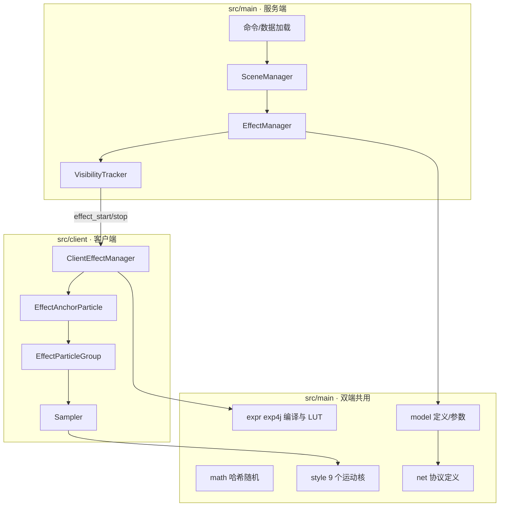
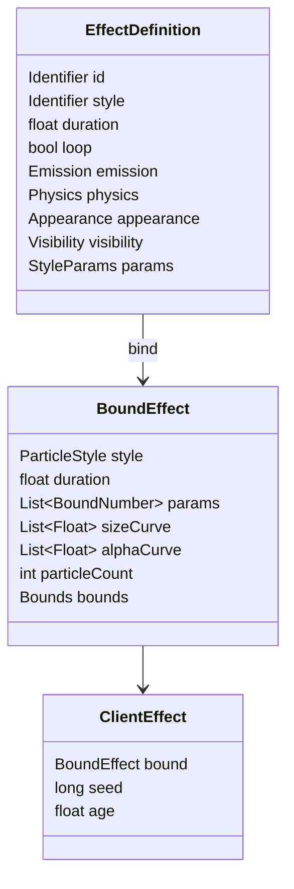
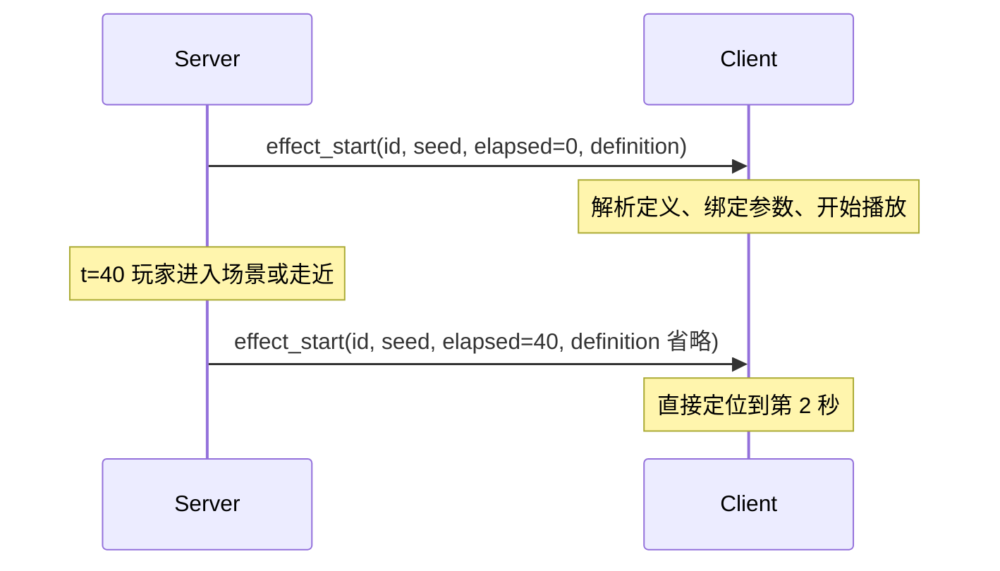
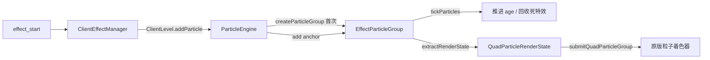

# 架构设计

> AstrorbitsParticle · Minecraft 26.2 / Fabric · 协议 v1

本文描述"服务端下发参数 + 客户端确定性模拟"的演唱会特效系统。
每种样式的参数与运动学见 [粒子样式表](粒子样式表.md)。

---

## 1. 目标与约束

### 1.1 功能目标

1. 服务端只下发**特效参数、随机种子、播放进度**，粒子由客户端自己计算、自己渲染。
2. 特效只下发给**位于演唱会场景内**且**在距离范围内**的客户端。
3. 客户端在特效播放中途才满足可见条件时，补发参数、进度和种子，让它**立刻**看到播到一半的画面。
4. 参数支持表达式（exp4j），使速度、半径、转速等可以随时间变化。
5. 开放的样式架构：新增一种样式只需实现一个运动核，不碰网络、渲染、生命周期。

### 1.2 非目标（v1）

- 不做 GPU 粒子（instancing / compute shader）；先在 CPU 上把批处理做好。
- 不做逐粒子碰撞、弹跳、流体交互。
- 不做客户端预测回滚。
- 不替代原版粒子系统。

### 1.3 硬约束

| 项 | 值 |
| --- | --- |
| Minecraft | 26.2（Loom 1.19-SNAPSHOT） |
| Loader / API | Fabric Loader 0.20.1，Fabric API 0.161.0+26.2 |
| 语言 | Kotlin 2.4.21，JVM target 25 |
| 源码布局 | `splitEnvironmentSourceSets()`：`src/main` 双端，`src/client` 仅客户端 |
| 服务端成本 | 每 10 tick 一次 O(玩家 × 特效) 扫描，不随粒子数增长 |
| 网络成本 | 常规特效启动包 ≤ 80 B |
| 客户端成本 | 1 万粒子单帧 ≤ 2 ms CPU |

---

## 2. 总体架构



### 2.1 模块职责

| 模块 | 包 | 职责 |
| --- | --- | --- |
| 模型 | `model` | `EffectDefinition` / `Emission` / `Physics` / `Appearance` / `Visibility`，JSON 编解码 |
| 表达式 | `expr` | exp4j 封装、变量白名单、常量折叠、时变参数烘 LUT |
| 随机 | `math` | 64 位哈希、球面/锥形采样、噪声 |
| 样式 | `style` | `ParticleStyle` SPI 与 9 个内置实现（纯数学，无渲染依赖） |
| 协议 | `net` | `CustomPacketPayload` 定义、编解码、版本常量 |
| 锚点类型 | `particle` | `EffectAnchorOptions` 与粒子类型注册 |
| 服务端 | `server` | 场景配置、活跃特效、可见性扫描、命令 |
| 客户端 | `client` | 接收、缓存定义、推进年龄、批量渲染 |

样式放在 `src/main` 而不是客户端，是为了让服务端也能算包围球、做参数校验，
并且**保证两端用同一份数学**，这是"确定性"的前提。

---

## 3. 数据模型

### 3.1 三段式



| 阶段 | 类型 | 内容 | 何时 |
| --- | --- | --- | --- |
| 定义期 | `EffectDefinition` | 原始字段 + 已编译表达式 + 参数模式 | 数据包加载 / 收到网络定义时 |
| 绑定期 | `BoundEffect` | 表达式→常量或 LUT，曲线→数组，预算粒子数、包围球 | 特效启动时，每特效一次 |
| 运行期 | `ClientEffect` | `age`、`seed`、采样输出 | 每帧 |

**运行期不出现任何解析、字符串、装箱。** 这是整份设计里最硬的一条规则。

### 3.2 参数值

```kotlin
sealed interface ParamValue {
    data class Num(val raw: String) : ParamValue         // "6.0" 或 "6*(1-u)"
    data class Vec3(val x: Float, val y: Float, val z: Float) : ParamValue
    data class Rgb(val r: Float, val g: Float, val b: Float) : ParamValue
    data class Curve(val points: FloatArray) : ParamValue // [u0,v0,u1,v1,...]
    data class Gradient(val points: FloatArray) : ParamValue
    data class Enum(val name: String) : ParamValue
}
```

参数保留原始 JSON，绑定期由 `Binder` 读成常量或 LUT；每个样式的默认值直接写在 `bind()` 里，
没有独立的 schema 描述。

### 3.3 服务端特效实例

```kotlin
class EffectInstance(
    val id: Long,
    val definition: EffectDefinition,
    val bound: BoundEffect,
    val seed: Long,
    val dimension: ResourceKey<Level>,
    val origin: Vec3,
    val startTick: Long,
    val endTick: Long,
    val bounds: Bounds,
    val subscribers: MutableSet<UUID>
)
```

`bound` 在服务端只用来算包围球和校验，不做粒子计算。

---

## 4. 表达式子系统（exp4j）

### 4.1 依赖

```groovy
repositories { mavenCentral() }

dependencies {
    implementation "net.objecthunter:exp4j:0.4.8"
    include "net.objecthunter:exp4j:0.4.8"     // jar-in-jar，随模组分发
}
```

exp4j 0.4.8 是最后一个发布版本（2017），无传递依赖、体积约 40 KB。
`include` 会把 jar 嵌进模组，Fabric Loader 会自动把它加入类路径，服务端与客户端都能用。

已知取舍：

| 风险 | 处理 |
| --- | --- |
| 项目已停止维护 | 只用它做纯数值求值，不依赖高级特性；封装在 `expr` 包内，必要时可整体替换 |
| `Expression` 可变、非线程安全 | 每个 `BoundEffect` 持有自己的实例，只在其所属线程求值；需要跨线程预计算时另建实例 |
| 报错信息粗糙 | 编译期捕获 `IllegalArgumentException`，回退默认值并带上参数路径记日志 |
| 表达式可能很长 | 长度上限 256 字符；编译结果按字符串缓存（LRU 512） |

### 4.2 变量与函数

| 变量 | 含义 |
| --- | --- |
| `t` | 特效局部时间（秒） |
| `d` | 总时长（秒） |
| `u` | `t/d` |
| `n` | 粒子数 |

exp4j 内置 `abs acos asin atan cbrt ceil cos cosh exp floor log log10 log2 sin sinh sqrt tan tanh`、
常量 `pi` `e`、运算符 `+ - * / % ^`。模组额外注册 `clamp(a,x,b)`、`mix(a,b,k)`、
`smoothstep(a,b,x)`、`fract(x)`、`sign(x)`、`step(a,x)`。

变量白名单在编译时固定：`ExpressionBuilder(src).variables("t","d","u","n")`，
未声明的标识符在 `validate()` 阶段就报错，不会留到运行期。

### 4.3 求值策略

```kotlin
sealed interface BoundNumber {
    @JvmInline value class Const(val v: Float) : BoundNumber
    class Lut(val samples: FloatArray, val duration: Float) : BoundNumber
}
```

- **常量表达式**（不含 `t`/`u`，也不依赖 LUT）：编译后立即 `evaluate()` 成 `Float`，之后零成本。
- **时变表达式**：绑定期按 `K = clamp(ceil(d*5), 16, 256)` 个采样点烘成 `FloatArray`，
  运行期 `sample(t) = lerp(lut[i], lut[i+1], f)`，无三角函数、无分配。
- **需要积分的量**（螺旋的角位移、轴向位移）：对表达式做累积梯形积分，存成单调 LUT，
  采样时取增量。

一条 `Lut` 采样约 5 ns；一个特效通常有 3–6 条 LUT，逐粒子只读其中几条。

### 4.4 曲线

`sizeByAge` / `alphaByAge` / `colorByAge` 与表达式共用同一套 `Lut`，只是采样点直接来自关键帧。
于是"表达式参数"和"关键帧曲线"在运行期是同一种东西，样式代码不需要区分。

---

## 5. 网络协议

### 5.1 为什么不用原版粒子包

原版 `ClientboundLevelParticlesPacket` 只能表达"一个 `ParticleOptions` + 位置/偏移/速度/数量"，
无法携带种子、播放进度、表达式定义；一个特效拆成一万包会把带宽打爆。
所以走自定义 `CustomPacketPayload`：**一包描述一整个特效**。

### 5.2 Payload 列表

全部注册在 `PayloadTypeRegistry.clientboundPlay()` 与 `serverboundPlay()`，`PROTOCOL_VERSION = 3`、`RNG_VERSION = 1`。

| id | 方向 | 触发 | 作用 |
| --- | --- | --- | --- |
| `astrorbitsparticle:handshake` | S2C | 玩家进入游戏 | 携带 `PROTOCOL_VERSION` 与 `RNG_VERSION`，客户端校验版本 |
| `astrorbitsparticle:effect_start` | S2C | 特效开始 / 玩家中途满足条件 | 启动或接续一个特效，需要时内联定义 |
| `astrorbitsparticle:effect_stop` | S2C | 特效结束 / 玩家离开可见范围 | 按 id 批量停止 |
| `astrorbitsparticle:effect_clear` | S2C | `/astrorticle reload` | 清空客户端特效与定义缓存 |
| `astrorbitsparticle:effect_impact` | C2S | 客户端检测到粒子碰撞 | 上报碰撞点，服务端据此生成 `impact` 子特效 |

### 5.3 `effect_start` 字段

```text
long    effectId            // 服务端自增，全局唯一
long    seed                // 随机流种子
varint  elapsedTicks        // 发送时刻已播放的 tick 数
float   x, y, z             // 特效原点
float   scale               // 整体缩放
int     definitionHash      // 定义内容哈希
bool    hasDefinition
utf     definition          // hasDefinition 为 true 时才写
```

不带定义约 45 B；带定义时加上定义 JSON 的长度，典型 400–900 B。

### 5.4 定义下发

- 服务端为每个玩家记录已下发的定义 hash，上限 128，超出后清空重发。
- 首次向某玩家下发某个定义时把 JSON 内联进 `effect_start`，之后同一 hash 只发 `hasDefinition = false`。
- 客户端按 hash 缓存定义，上限 64；断线后两端缓存一起失效，重连会重新下发。
- 没有额外的定义请求往返：客户端查不到定义时丢弃该特效并记日志。

### 5.5 时序



**关键点**：协议只传 `elapsedTicks`，客户端按它设置首帧年龄，之后用自己的单调时钟推进。

### 5.6 兼容与降级

- 客户端未装模组：`ServerPlayNetworking.canSend(player, type)` 返回 `false`，服务端跳过该玩家。
- 未知样式或定义解析失败：客户端丢弃该特效并记日志，不影响其他特效。
- 版本不一致：玩家进入游戏时服务端发送 `handshake`，客户端比对 `PROTOCOL_VERSION` 与 `RNG_VERSION`。只要有一项不同，客户端清空缓存、丢弃后续 `effect_start`，控制台记 warn，并在聊天栏提示。

---

## 6. 可见性与中途加入

### 6.1 场景定义

场景是服务端配置（`config/astrorbitsparticle/scenes.json`），带世界与包围盒：

```json
{
  "scenes": [
    {
      "id": "astrorbitsparticle:main_stage",
      "dimension": "minecraft:overworld",
      "min": [-48, 56, -48],
      "max": [48, 144, 48],
      "viewDistance": 128.0,
      "scanInterval": 10
    }
  ]
}
```

场景包围盒是"是不是观众"的判定，距离是"看不看得见"的判定，两者都要满足。

### 6.2 判定

```text
scene       = e.scene                                  // requireScene=false 的全局特效可能为 null
inScene     = scene != null && scene.contains(p.pos)
viewLimit(e)= scene != null ? min(scene.viewDistance, def.visibility.viewDistance)
                            : def.visibility.viewDistance

eligible(p, e) =
      p.dimension == e.dimension
   && (inScene || !def.visibility.requireScene)
   && distanceSq(p.pos, e.bounds.center) <= (viewLimit(e) + e.bounds.radius)²
```

- `bounds` 由 `BoundEffect` 在绑定期采样 24 个时间点求出包围球，比手写"AABB + 半径"可靠。
- **迟滞**：进入用 `R`，退出用 `1.15R`；避免玩家在边界抖动导致反复 start/stop。
- **错峰**：扫描按 `player.id % scanInterval` 分摊到不同 tick，避免 20 tick 周期性的尖峰。

### 6.3 订阅差量

```kotlin
// 每 scanInterval tick
for (effect in activeEffects) {
    for (player in playersIn(effect.dimension)) {
        val want = eligible(player, effect)
        val has  = player.id in effect.subscribers
        when {
            want && !has -> sendStart(player, effect, elapsed = serverTick - effect.startTick)
            !want && has -> sendStop(player, effect.id)
        }
    }
}
```

`sendStart` 里的 `elapsed` 就是"播放进度"：

```kotlin
var elapsed = serverTick - effect.startTick
if (effect.definition.loop) {
    elapsed %= durationTicks
} else if (elapsed >= durationTicks) {
    return                       // 已经放完，不补发
}
```

### 6.4 中途加入为什么能直接正确

因为所有粒子的出生时刻、寿命、位置都是 `(seed, index, t)` 的**闭式函数**（见样式表 1.4）：

- 客户端拿到 `elapsed = 2.0 s`，直接令 `t = 2.0` 采样；
- 该出生但还没死的粒子会自动出现，早该死掉的自动不出现；
- 喷泉这类"持续发射"的样式，也只需要 `birth_i < t < birth_i + life_i` 的索引筛选。

采样只依赖年龄和种子：中途加入不用补发历史粒子，也不用等待。

### 6.5 生命周期边界

| 事件 | 处理 |
| --- | --- |
| 玩家死亡/重生 | 清空该玩家的订阅集，重生后重新扫描（新位置大概率不满足条件） |
| 换维度 | 维度不匹配 → 差量里自然发 `stop` |
| 断线重连 | 新连接无订阅状态，首次扫描重新 `sendStart(elapsed)` |
| `/reload` | 已绑定特效保持已绑定的 `BoundEffect`，新特效用新定义；定义 hash 变化会让客户端重新拉取 |
| 服务端卡顿 | `elapsed` 以 game time 为准，跳过的时间由客户端一次性补上（`dt` 上限 50 ms） |

---

## 7. 客户端模拟

### 7.1 确定性随机

用自写的 splitmix64，避开 `java.util.Random` 与 `RandomSource` 的版本差异。
自建 4 行 splitmix64，写进协议：

```kotlin
private val M1 = 0xBF58476D1CE4E5B9uL.toLong()
private val M2 = 0x94D049BB133111EBuL.toLong()
private val K1 = 0x9E3779B97F4A7C15uL.toLong()
private val K2 = 0xC2B2AE3D27D4EB4FuL.toLong()

private fun mix(z0: Long): Long {
    var z = z0
    z = (z xor (z ushr 30)) * M1
    z = (z xor (z ushr 27)) * M2
    return z xor (z ushr 31)
}
fun hash(seed: Long, stream: Int, index: Int, draw: Int = 0): Long =
    mix(seed xor (stream.toLong() * K1) xor (index.toLong() * K2) xor (draw.toLong() shl 32))
fun unit(seed: Long, stream: Int, index: Int, draw: Int = 0): Float =
    (hash(seed, stream, index, draw) ushr 40).toFloat() * (1f / (1 shl 24))
```

`hash64`、流编号、取用顺序共同构成 `rngVersion = 1`，改动即为不兼容变更。

### 7.2 采样

```kotlin
class ClientEffect(val bound: BoundEffect, val seed: Long) {
    var age = 0f           // 秒，单调递增
    fun sampleInto(out: ParticleBuffer) { bound.style.sample(bound, seed, age, out) }

    // 中途加入：直接把 age 设到目标进度，无需重放
    fun seek(seconds: Float) { age = seconds }
}
```

`ParticleBuffer` 是结构体数组（SoA）：`FloatArray` × {pos, size, alpha, rgb, uv}，预分配、可复用。
`sampleInto` 的实现是纯计算：查 LUT、读哈希、写数组，没有对象分配、没有虚调用嵌套。

### 7.3 时间推进

```kotlin
val now = System.nanoTime()
val dt = ((now - lastNanos) / 1e9).coerceIn(0.0, 0.05).toFloat()   // 单帧最多补 50 ms
age += dt
lastNanos = now

// 中途加入时直接跳到进度点，再按帧推进
age = elapsedSeconds + (now - recvNanos) / 1e9f
```

- 用 `nanoTime` 而不是 tick，保证 60/144 Hz 下运动平滑；`partialTick` 只用于渲染插值。
- `dt` 上限 50 ms，避免 GC/卡顿后粒子瞬移。
- 单机暂停（`Minecraft.isPaused()`）时冻结。
- `loop` 与 `reverse` 同时启用时，先把 `age` 对 `duration` 取模，再按 `duration - age` 采样；否则 `age` 超过 `duration` 后会一直停在起始帧。

### 7.4 状态式兜底

个别未来的样式（碰撞、弹簧、跟随实体）无法解析。留一个扩展点：

```kotlin
interface StatefulStyle : ParticleStyle {
    /** 从 0 重放到 age；返回是否完成 */
    fun replayTo(age: Float): Boolean
    val maxWarmupTicks: Int
}
```

中途加入时最多重放 `maxWarmupTicks`（默认 200 tick），超出则从"看起来合理"的状态开始。
v1 的 9 个样式全部是解析式，不会走到这条路径。

---

## 8. 客户端渲染

### 8.1 26.2 的管线

26.2 把粒子拆成了三段：

1. `ParticleEngine.tick()` → 每个 `ParticleGroup.tickParticles()`
2. `ParticleEngine.extract(ParticlesRenderState, Frustum, Camera, partialTick)` → 每个 `ParticleGroup.extractRenderState(...)`
3. `ParticlesRenderState.submit(...)` → `SubmitNodeCollector.submitQuadParticleGroup(QuadParticleRenderState)`

Fabric API 提供了两个关键注册点：

- `ParticleProviderRegistry`：`ParticleType` → `ParticleProvider`
- `ParticleGroupRegistry.register(renderType) { engine -> ParticleGroup }`：为一类渲染层换掉默认的 `QuadParticleGroup`

### 8.2 接入方式



**锚点粒子技巧**：自定义 `ParticleRenderType("astrorbitsparticle:effect", "AOP")`，
客户端注册它的组工厂。收到 `effect_start` 后不直接调引擎内部方法，而是走标准路径：

```kotlin
level.addParticle(EffectAnchorOptions(effectId), x, y, z, 0.0, 0.0, 0.0)
```

`ParticleProvider` 造出一个**不渲染**的 `EffectAnchorParticle`，它的 `getGroup()` 返回自定义类型。
引擎首次遇到该类型时用工厂创建 `EffectParticleGroup`，再 `add(anchor)`；组在 `add` 里把
`ClientEffect` 挂进自己的活动列表，锚点粒子本身只负责"让组存在，并与特效同生共死"。

锚点用的 `ParticleOptions` 仍然需要注册一个 `ParticleType`，否则 `ParticleEngine` 查不到 provider：

```kotlin
val EFFECT_ANCHOR: ParticleType<EffectAnchorOptions> = Registry.register(
    BuiltInRegistries.PARTICLE_TYPE, id("effect_anchor"),
    FabricParticleTypes.complex(EffectAnchorOptions.CODEC, EffectAnchorOptions.STREAM_CODEC)
)
```

它永远不经过原版粒子包，两个 codec 只是注册接口要求的占位（仍建议写成合法实现，
以便 `/particle` 命令和调试工具有个能用的入口）。

不改 `ParticleEngine` 的私有字段，也不影响原版粒子。

### 8.3 批渲染

`EffectParticleGroup.extractRenderState` 里：

```kotlin
val rs = QuadParticleRenderState()
val scratch = ParticleBuffer()                    // 复用的 SoA 缓冲
for (effect in visibleEffects) {
    if (!frustum.isVisible(effect.bounds.aabb)) continue
    effect.sampleInto(scratch)                    // age 已含帧插值
    val layer = layers[effect.blend]              // 按贴图 + 混合模式分组
    val stride = effect.lodStride(distTo(effect))
    for (i in 0 until scratch.count step stride) {
        rs.add(layer, scratch.x[i], scratch.y[i], scratch.z[i], /* size, color, alpha, uv, light */)
    }
}
return rs
```

- 所有粒子写进同一个 `QuadParticleRenderState`，每个 layer 一次 draw call。
- `blend = additive` 的特效使用单独的粒子管线（`PARTICLE_SNIPPET` + `ADDITIVE`），与半透明层分开提交；启动时通过 Iris API 的 `assignPipeline` 把它登记为 `PARTICLES_TRANSLUCENT`，否则光影下不绘制。
- `stretch > 0` 时按样式给出的速度向量额外画 3 段递减的面片；`spin` 旋转面片四元数。
- 不创建任何 `Particle` 对象：省掉每个粒子 ~100 B 的对象头与 GC 压力。
- `add` 是纯字段写入，无分配；1 万粒子约 1 ms。
- 不透明/半透明用不同 `SingleQuadParticle.Layer`，由原版按层排序。

> 若后续需要自发光叠加、无贴图软粒子，可改用 `SubmitNodeCollector.submitCustomGeometry`
> 配自定义 `RenderType`；这需要先在 26.2 的 `RenderSetup` 上做一次验证，排在 M2 之后。

### 8.4 LOD 与预算

渲染前先按距离与预算算出本帧的采样步长，逐特效再取两者较大值：

```text
lod    = clamp(1 - (dist - 24)/(96 - 24) * 0.6, 0.35, 1)
stride = max(1, round(1 / lod))       // 近处 1，远处 3
```

| 项 | 值 | 行为 |
| --- | --- | --- |
| 单特效上限 | 8192 | 定义期校验 |
| 客户端总可见粒子 | 20000 | 计划粒子数超出时按比例提升步长，最多 4 |
| 单帧采样预算 | 4 ms | 连续 30 帧超出就加一档步长；连续 120 帧低于 2 ms 再降回 |
| 特效上限 | 64 | 只渲染距离最近的 64 个 |

步长按 `i += stride` 抽样，不改变粒子的随机量，所以景深变化时画面不会重新随机。

### 8.5 剔除

- **视锥**：`Frustum.isVisible(effect.cullBox)`，包围球半径在绑定阶段按 6 个年龄采样取最大粒子距离，再按 `boundsPadding` 外扩。
- **距离**：由服务端在可见性扫描时过滤，客户端不重复判断。
- **零面积**：采样阶段丢弃 `alpha ≤ 0.004` 与 `size ≤ 0` 的粒子，不写顶点。

---

## 9. 性能预算

### 9.1 服务端

| 项 | 量级 |
| --- | --- |
| 扫描 | `玩家数 × 活跃特效数 / scanInterval` tick，40 特效 × 100 人 / 10 = 400 次判定/tick |
| 每特效内存 | ~4–8 KB（主要是参数 LUT），定义与样式共享 |
| 带宽 | 100 人 × 40 特效 × 45 B ≈ 180 KB（只发生在进服/进场瞬间） |

服务端**不做任何粒子计算**，CPU 与特效规模无关，只与"玩家 × 特效"有关。

### 9.2 客户端

| 操作 | 单粒子成本 |
| --- | --- |
| 哈希取数（4 次） | ~10 ns |
| LUT 采样（3 条） | ~15 ns |
| 三角/开方 | ~30–80 ns |
| 顶点写入 | ~20 ns |
| 合计 | ~80–120 ns |

1 万粒子 ≈ 0.8–1.2 ms/帧，占 60 FPS 预算（16.6 ms）的 5–7%。
超出预算时按 8.4 降级，而不是丢帧。

---

## 10. 扩展性

### 10.1 样式 SPI

```kotlin
interface ParticleStyle {
    val id: String
    fun bind(binder: Binder): BoundStyle
    fun sample(effect: BoundEffect, origin: Vec3, seed: Long, age: Float, out: ParticleBuffer)
}

object ParticleStyles {
    fun register(style: ParticleStyle)
    fun get(id: Identifier): ParticleStyle?
    fun all(): Collection<ParticleStyle>
}
```

内置样式在 `AstrorbitsParticle.onInitialize()` 注册。两端注册表必须一致；样式集合本身不在握手校验范围内，服务端用到的样式在客户端缺失时，客户端丢弃该特效并记日志。
其他模组的依赖方式、调用方法与自定义样式示例见 [接口文档](接口文档.md)。

### 10.3 数据驱动

- 定义：`config/astrorbitsparticle/effects/*.json` 或数据包 `data/<namespace>/effects/*.json`，同 id 时 config 覆盖数据包；`/astrorticle reload` 重新加载。
- 场景：`config/astrorbitsparticle/scenes.json`，服务器启动时读取，同样由 `/astrorticle reload` 重载。
- 子特效：定义里的 `subEffect` 在本体结束时生成目标定义一次，只展开一层。`subEffectTrigger = "impact"` 时改由客户端上报粒子碰撞点，服务端在碰撞点生成，同样只展开一层。
- 两者都不需要重新编译模组；首次启动会生成示例。

---

## 11. 失败模式

| 症状 | 原因 | 表现 | 处理 |
| --- | --- | --- | --- |
| 特效不出现 | 客户端没有对应 hash 的定义 | 静默 | 客户端丢弃并记日志；服务端首次下发时总会内联定义 |
| 定义被拒绝 | 表达式或参数非法 | 服务端不生成特效 | 加载期与生成时记录 `样式 + 参数路径 + 原因` |
| 画面与其他玩家不同 | RNG 版本不一致 | 粒子分布不同 | 握手比对不一致时客户端丢弃特效并提示 |
| 粒子糊屏 | 多个特效叠加且 `count` 都很大 | 掉帧 | 全局预算、LOD 与单帧降级见 8.4，上限可在 config.json 调整 |
| 内存上涨 | 定义缓存无上限 | — | 服务端 128、客户端 64 上限，超出清空 |
| 中途加入位置不对 | 客户端用 tick 而非 `elapsedTicks` 定位 | 偏差 1 tick 内 | 用 `elapsedTicks` 设置首帧年龄 |
| 碰撞子特效不出现 | 目标定义缺失、目标自身带 `subEffect`，或粒子没有进入固体方块 | 无子特效 | 看日志里的 impact 行；确认 `subEffectTrigger` 与目标定义 |

---

## 12. 测试计划

黄金采样已实现：`gradlew verifyGolden` 按固定种子与年龄采样 9 个测试预设，与 `golden/` 下的基线逐字节比较；`gradlew updateGolden` 重写基线。`build` 会执行校验。其余层级待补：

| 层 | 方法 |
| --- | --- |
| 表达式 | 单测：语法、变量白名单、常量折叠、LUT 误差 < 0.5% |
| 随机 | 单测：`hash` 固定输入固定输出；跨 JVM 一致 |
| 样式 | **黄金采样**：每个样式在 `t = 0/0.5/1/2/d` 采样 64 个粒子，与基线文件比对；改样式必须同步更新基线，防止无意破坏回放兼容 |
| 中途加入 | 属性测试：采样器无状态，因此对同一个 `t`，逐帧推进与直接 seek 得到的缓冲逐位相同 |
| 网络 | gametest：伪造 `effect_start`，验证客户端状态机；断开/重连验证幂等 |
| 渲染 | 客户端 gametest：断言 `ParticleEngine` 中存在自定义组且 render state 非空 |
| 压力 | 40 个特效、合计 2 万可见粒子、100 假玩家，测 TPS 与帧时间 |

黄金采样是这套架构最重要的回归测试：它把"确定性"变成可断言的产物。

---

## 13. 落地路径

| 阶段 | 内容 | 状态 |
| --- | --- | --- |
| M0 | 骨架：模型、表达式、协议、1 个样式、渲染通路打穿 | 完成 |
| M1 | 9 个样式 + 参数校验 | 完成；参数校验在绑定期完成，没有独立 schema |
| M2 | 批渲染、LOD、预算与降级 | 完成 |
| M3 | 场景、可见性、中途加入、断线重连 | 完成；断线重连靠新连接重新下发 |
| M4 | 命令、示例配置、文档 | 命令与示例配置完成；参数文档由 `generateStyleDocs` 生成；调试可视化未做 |
| M5 | 数据包定义、上限配置、逆向播放、结束与碰撞子特效 | 完成；碰撞按客户端采样点检测，未做连续碰撞 |

M0 的接入点已经验证：自定义 `ParticleGroup` 工厂 + 锚点粒子能被 `ParticleEngine`
的 `tickParticles` / `extractRenderState` 正常调度。

---

## 14. 目录与依赖

### 14.1 包结构

```text
src/main/kotlin/com/example/astrorbitsparticle/
├── AstrorbitsParticle.kt          入口：注册样式、协议、命令与服务器事件
├── expr/                          Exprs、BoundNumber、LUT
├── math/                          HashRandom、Streams
├── model/                         EffectDefinition、Emission、Appearance…
├── net/                           effect_start/stop/clear 三个 payload
├── particle/                      EffectAnchorOptions
├── server/                        ServerEffects、Scene、EffectsCommand
└── style/                         ParticleStyle、Binder、9 个样式

src/client/kotlin/com/example/astrorbitsparticle/client/
├── AstrorbitsParticleClient.kt    入口：注册 provider、组工厂、收包
├── ClientEffects.kt               定义缓存与特效管理
├── EffectAnchorParticle.kt        锚点粒子
└── EffectParticleGroup.kt         批量采样与渲染
```

### 14.2 `build.gradle` 变更

```groovy
repositories {
    mavenCentral()
}

dependencies {
    // ... 现有依赖
    implementation "net.objecthunter:exp4j:0.4.8"
    include "net.objecthunter:exp4j:0.4.8"
}
```

不需要新增模组依赖或修改 `fabric.mod.json`。

---

## 附录：设计决策速查

| 决策 | 选择 | 理由 |
| --- | --- | --- |
| 粒子由谁计算 | 客户端 | 服务端只发参数，1 万粒子不占 TPS |
| 随机怎么传 | 只传 seed | 传序列要几十 KB；seed 让两端得到同一序列 |
| 中途加入 | 传 `elapsedTicks` + seed | 解析式采样，零重放 |
| 粒子是否有状态 | 无（解析式） | 保证一致性、可跳转、可 LOD |
| 表达式何时求值 | 绑定期 → 常量/LUT | 运行期零解析 |
| 怎么接进原版 | `ParticleGroup` + 锚点粒子 | 无 mixin，不碰私有字段 |
| 怎么画 | `QuadParticleRenderState` | 复用原版着色器与排序，一 layer 一 draw |
| 何时下发 | 每 10 tick 扫描 + 迟滞 | 成本可控，避免抖动 |
