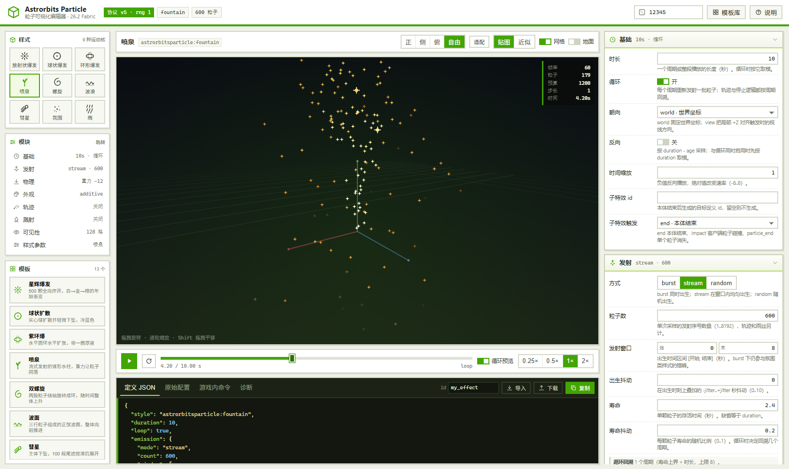
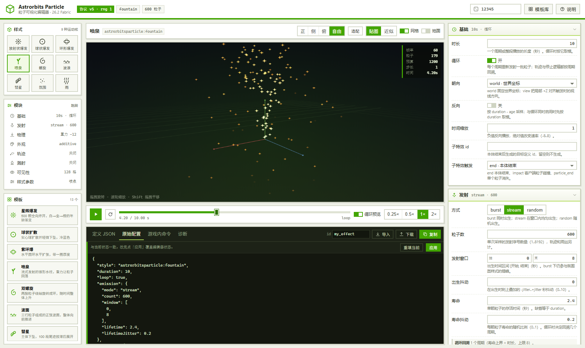
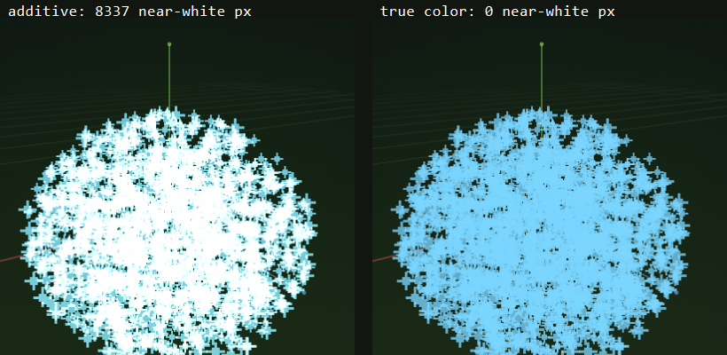

# 粒子可视化编辑器

浏览器里编辑 AstrorbitsParticle 的特效定义，逐帧按模组的客户端采样算法画粒子，
并导出 `config/astrorbitsparticle/effects/*.json` 或游戏内测试命令。
不用启动客户端，双击 `index.html` 即可，零构建、无依赖。



## 界面

| 区域 | 内容 |
| --- | --- |
| 顶栏 | 随机种子、模板库、说明；显示协议版本、当前样式、粒子数 |
| 左栏 | 9 个样式图标、8 个模块跳转、13 个模板 |
| 中栏 | Canvas 预览（拖拽旋转、滚轮缩放、Shift 拖拽平移）、取景与贴图开关、时间轴、输出区 |
| 右栏 | 折叠分区：基础、发射、物理、外观、轨迹、溅射、可见性、样式参数，每区有独立图标 |

输出区四个页签：

| 页签 | 用途 |
| --- | --- |
| 定义 JSON | 当前定义序列化结果，只读高亮，可复制或下载 `<id>.json` |
| 原始配置 | 载入时的定义原文，可直接改再点「应用」覆盖编辑器状态；「重填当前」换成当前生成的定义 |
| 游戏内命令 | 只有一行内联定义 `/astrorticle effect play {...}`，省略与解析默认值相同的字段，复制即可执行；下载为 `.mcfunction` |
| 诊断 | 粒子数、预算上限、包围球、回溯周期、贴图来源、参数问题；下载为 `.txt` |

命令页的 JSON 是**最小等价定义**：省略的字段由解析器补默认值，采样结果与原定义逐位相同
（`golden-check.js` 会对 13 个模板验证这一点）。完整定义看「定义 JSON」页。

内联命令通常 380–560 字符。26.2 的 `ChatScreen` 在构造输入框后调用 `setMaxLength(256)`，
所以聊天栏粘不下完整定义，会被截断；改用命令方块（上限 32500 字符）或下载的 `.mcfunction` 执行。
复制时的提示与「诊断」页都会给出实际字符数。



快捷键：`空格` 播放暂停、`R` 回到起点、`←/→` 逐帧、`1`–`9` 切样式、`G` 网格、`F` 适配视图。

URL 参数可直接定位状态，便于分享：

```text
index.html?preset=show-golden-fountain&age=4&paused=1&ground=1&seed=12345
```

`preset` 取 `presets.js` 里的 id 或样式名；`ground=1` 打开地面（splash 检测面）；`grid=0` 关网格。

## 目录

| 路径 | 内容 |
| --- | --- |
| `index.html` | 结构 + 内联 SVG 图标集 |
| `app.css` | 浅底绿强调 + 直角描边；输出区深底绿边 |
| `sprites.js` | 6 种程序化贴图，兼作 `astro/` 的生成源 |
| `core.js` | 哈希随机、球面/锥形采样、解析积分、曲线与渐变、exp4j 子集、缓冲与 emit |
| `styles.js` | 9 个样式的参数声明与运动核、Binder |
| `effect.js` | 定义解析与序列化、绑定、包围球、播放状态机 |
| `presets.js` | 9 个测试预设（与 `TestPresets.kt` 逐字节一致）+ 4 个演唱会模板 |
| `ui.js` | 控件、Canvas 渲染、状态与事件 |
| `assets/particles/` | 贴图与清单，见下节 |
| `tools/` | 校验、截图、贴图同步与导出脚本 |
| `docs/` | README 用的截图 |

## 贴图

页面不读客户端图集，而是读 `assets/particles/manifest.js`（用 JS 而不是 JSON：`file://` 下 `fetch` 会被拦）。
清单把 sprite id 映射到一到多个 PNG，来源与优先级如下：

| 来源 | 位置 | 是否进版本库 | 说明 |
| --- | --- | --- | --- |
| 近似贴图 | `astro/` | 是 | 由 `sprites.js` 生成的 6 种形状，仓库自带 |
| 模组贴图 | `<namespace>/` | 是 | 从 `src/client/resources/assets/<ns>/textures/particle/` 同步 |
| 原版贴图 | `minecraft/` | 否 | 从本机 Loom 缓存的客户端 jar 解出，只在本地存在 |

命中顺序是原版 > 模组 > 近似；都没有时用 `sprites.js` 的程序化形状，画面不会空。

### 加贴图的两条路

1. **给模组加粒子贴图**：把 PNG 放进 `src/client/resources/assets/astrorbitsparticle/textures/particle/`，
   然后

   ```powershell
   node web/tools/sync-assets.js
   ```

   编辑器里就多出 `astrorbitsparticle:<文件名>` 这个 id。

2. **只给编辑器加**：把 PNG 放进 `web/assets/particles/<namespace>/`，再跑同一个脚本。
   文件名就是贴图名，父目录名就是命名空间。

### 原版贴图

```powershell
node web/tools/sync-assets.js --vanilla
```

从 `~/.gradle/caches/fabric-loom/<版本>/minecraft-client.jar` 解出
`assets/minecraft/textures/particle/` 下的全部贴图，并读取 `assets/minecraft/particles/*.json`
把「一个定义对应多张贴图」的关系写进清单（对应 `appearance.spriteVariation` 的三种变体）。
解出的文件在 `.gitignore` 里，不会进版本库。

### 重新生成近似贴图

```powershell
node web/tools/gen-astro-textures.js   # 用 headless Chrome 把 sprites.js 的形状导出成 PNG
node web/tools/sync-assets.js          # 重建清单
```

### 颜色显示

叠加混合（`blend: additive`）在粒子密集处会刷白，这是定义本身的行为，游戏内一样。
两个只看预览、不改定义的辅助：

- 中栏「原色」：强制普通混合，逐粒子显示真实颜色，用来判断颜色和渐变对不对。
- 「外观 → 颜色预览」：画出当前颜色条，标注各点的 u 与色值。发白多半是渐变起点为 `#FFFFFF`，
  或者密度过高叠加饱和；色板起点与密度都能在编辑器里直接调。



左图是定义里的叠加混合，密集处被累加到纯白；右图打开「原色」后按普通混合提交，
同一批粒子显示 `#7FD4FF`，近白像素从 8337 个降到 0 个。

### 贴图模式

中栏工具条的「贴图 / 近似」二选一：

- **贴图**：用清单里的真实 PNG，和游戏内一致。原版贴图常见 8×8，单个亮点很小，
  远距离下会偏暗，这是贴图本身的样子。
- **近似**：用 `sprites.js` 的程序化形状，粒子更大更亮，适合看运动、层次与时间结构。

渲染用最近邻采样，8×8 / 16×16 的小贴图按整数倍放大到屏幕像素，像素边缘保持方块状；
显示尺寸不小于贴图原始像素数，避免单个亮点被采样丢掉。「外观 → 贴图」下方有缩略图，
给出引用的文件名、像素尺寸与来源，可以直接确认画面用的是哪张图。

## 算法对照

| 模组源码 | 这里的实现 |
| --- | --- |
| `math/HashRandom.kt` | `core.js` `Rand`：splitmix64 拆成高低 32 位；按 `(seed, stream, draw)` 预建表，表值与逐次求哈希逐位相同 |
| `math/HashRandom.kt` `Streams` | 0–9 十条流的编号原样保留 |
| `style/StyleMath.kt` | `sphereInto` / `coneInto` / `orthoBasis` / `posInto`（阻尼闭式解）/ `jitterInto` / `fract` / `smoothstep`，关键路径按 JVM float 语义逐步舍入 |
| `style/StyleSupport.kt` | `emit`：尺寸抖动、两条曲线、颜色渐变、亮度抖动、`alpha ≤ 0.004` 丢弃 |
| `style/ParticleStyle.kt` | `FloatCurve.at`、`ColorGradient.at`、`Binder`、`ParticleBuffer`、包围球 |
| `expr/Exprs.kt` | exp4j 子集（含 `clamp/mix/smoothstep/fract/sign/step`）、LUT 采样数 `clamp(d·5,16,256)`、梯形积分 |
| `style/BurstStyles.kt` `FlowStyles.kt` `AmbientStyles.kt` | 9 个运动核，随机流的取用顺序与 draw 编号逐条对齐 |
| `model/Model.kt` | `parseDefinition` / `definitionToJson`，默认值与夹取范围一致 |
| `client/ClientEffects.kt` | `Playback`：周期回溯 ≤8、`timeScale`/`reverse`、停止后过滤出生、time/distance/drift 轨迹、溅射、`orientation=view` 旋转 |
| `client/EffectParticleGroup.kt` | 拉伸 3 段、additive/alpha 两条混合路径、LOD 抽样、三种贴图变体 |

## 校验

```powershell
node web/tools/golden-check.js                 # 9 样式 × 4 年龄，与 golden/*.txt 逐值比对
node web/tools/uitest.js                       # 49 条界面交互断言，跑 headless Chrome
node web/tools/probe.js "?preset=wave&age=3"   # 读运行时状态、抓脚本错误、截图
```

`golden-check`：9 个样式全部通过；11637 行基线里 93% 逐字节相同，
其余只在最后一位（1e-5 格）有 float32 与 JS double 的舍入差；粒子数与 ARGB 100% 一致。

## 与游戏内渲染的差异

- 没有 Iris 管线分配、Sodium 精灵标记、世界光照（`fullbright=false` 不影响预览亮度）。
- 溅射用一片自适应高度的水平地面代替逐方块查询，检测频率按帧而不是 20 tick。
- LOD 按 9000 粒子固定上限抽样，模组里按距离和帧预算动态降级。
- 不做 64 个特效 / 2 万可见粒子的全局预算，只显示单特效预算估算。
- `particle` 变体的贴图选择用哈希低 32 位近似（模组用 `(hash ushr 1) % n`），只影响选取哪张图。

## 已知实现细节

`spiral` 样式的所有粒子共享 `axial.at(age)`、只有 `angular.at(local)` 逐粒子，
所以画面是「一圈随年龄上升并旋转的粒子环」，不是螺旋柱；`golden/spiral.txt`
在 `age=2.0` 处所有 y≈1.8 可以印证。要得到螺旋柱，轴向位移应该用 `params.axial.at(local)`，
这是模组侧的行为，编辑器按现状复刻。

## 加一个样式

1. 在 `styles.js` 的 `STYLES` 里追加对象：`id`、`title`、`icon`、`summary`、
   `schema`（`num/int/bool/vec/numbers/texts/color` 声明）、`bind`、`sample`。
2. `sample(effect, origin, rand, age, out)` 只调用 `C.*` 的数学与 `C.emit`，
   随机量一律走 `rand.unit/signed(流, 序号, draw)`。
3. 需要时补 `birthAge`、`stretchVector`、`particleCapacity`、`cyclicEmission`。
4. 给 `index.html` 的图标集加一个 `s-<icon>` symbol。
5. 跑 `golden-check`，旧样式的基线不应变化。
